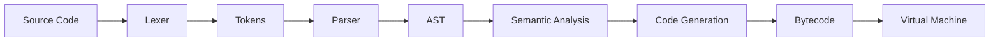
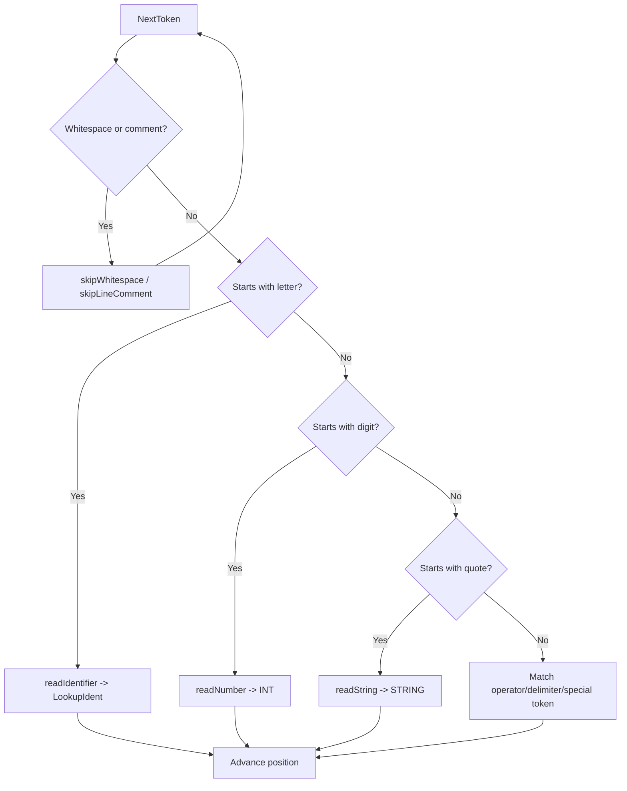

# Lexer in Gocraft

## Overview

A lexer, also called a lexical analyzer, is the first major stage in a compiler front end. It reads source code as raw characters and groups them into meaningful units called tokens.

This step does not interpret the program's meaning; it only identifies the vocabulary of the language.

```text
let age = 25;
```

becomes:

```text
LET("let")
IDENT("age")
ASSIGN("=")
INT("25")
SEMICOLON(";")
EOF("")
```

## Compiler pipeline



The Gocraft compiler follows this progression:

1. Source code is read as plain text.
2. The lexer converts characters into tokens.
3. The parser builds an abstract syntax tree.
4. Semantic analysis validates rules such as declarations and scope.
5. Code generation produces executable bytecode.
6. The virtual machine runs the program.

## Token model

The token package defines both the token kind and the literal text that appeared in the source.

```go
type TokenType string

type Token struct {
    Type    TokenType
    Literal string
}
```

### Token responsibilities

- `Type`: identifies the category of the token.
- `Literal`: stores the exact text from the source.

Example:

```go
token.Token{
    Type:    token.INT,
    Literal: "25",
}
```

The lexer also uses keyword lookup to distinguish reserved words from identifiers.

```go
func LookupIdent(ident string) TokenType
```

If a word is a reserved keyword such as `let`, `fn`, or `return`, the lexer emits the matching keyword token. Otherwise it emits `IDENT`.

## Lexer structure

The lexer keeps a small amount of state so it can read through the input stream one character at a time.

```go
type Lexer struct {
    input        string
    position     int
    readPosition int
    ch           byte
}
```

| Field            | Responsibility                     |
| ---------------- | ---------------------------------- |
| `input`        | The full source text being scanned |
| `position`     | Current character index            |
| `readPosition` | Next character index               |
| `ch`           | Current byte being processed       |

The lexer uses `0` as the EOF sentinel, which marks the end of input.

## Reading workflow



## Important helper functions

| Function              | Responsibility                             |
| --------------------- | ------------------------------------------ |
| `New()`             | Creates and initializes the lexer          |
| `readChar()`        | Advances one byte through the source       |
| `peekChar()`        | Looks ahead without consuming characters   |
| `skipWhitespace()`  | Ignores spaces, tabs, and newlines         |
| `readIdentifier()`  | Reads variable and function names          |
| `readNumber()`      | Reads integer literals                     |
| `readString()`      | Reads quoted string literals               |
| `skipLineComment()` | Ignores `//` comments                    |
| `isLetter()`        | Checks whether a byte begins an identifier |
| `isDigit()`         | Checks whether a byte is a digit           |
| `NextToken()`       | Produces the next token from the input     |

## Operator handling

Single-character operators are handled directly:

```text
+ - * / ! < >
```

Multi-character operators are recognized with one-character lookahead:

```text
== != <= >= && ||
```

Example logic:

```go
if l.peekChar() == '=' {
    ch := l.ch
    l.readChar()
    literal := string(ch) + string(l.ch)
}
```

This pattern allows the lexer to combine two characters into a single operator token such as `==` or `!=`.

## Current capabilities

| Feature              | Supported                                                          |
| -------------------- | ------------------------------------------------------------------ |
| Keywords             | `let`, `fn`, `if`, `else`, `return`, `true`, `false` |
| Identifiers          | `age`, `salary`, `calculate`                                 |
| Integers             | `10`, `250`, `50000`                                         |
| Strings              | `"hello"`, `"Gocraft"`                                         |
| Arithmetic operators | `+`, `-`, `*`, `/`                                         |
| Comparison operators | `==`, `!=`, `<`, `>`, `<=`, `>=`                       |
| Logical operators    | `&&`, `                                                          |
| Delimiters           | `()`, `{}`, `,`, `;`                                       |
| Comments             | `//` single-line comment                                         |
| Invalid characters   | `ILLEGAL`                                                        |
| End of input         | `EOF`                                                            |

## Example tokenization walk-through

```mermaid
sequenceDiagram
    participant User as Source Text
    participant L as Lexer
    participant T as Token Stream

    User->>L: "let age = 25;"
    L->>L: skipWhitespace
    L->>L: readIdentifier -> "let"
    L->>T: LET("let")
    L->>L: readWhitespace
    L->>L: readIdentifier -> "age"
    L->>T: IDENT("age")
    L->>L: readWhitespace and assign symbol
    L->>T: ASSIGN("=")
    L->>L: readNumber -> "25"
    L->>T: INT("25")
    L->>L: read semicolon
    L->>T: SEMICOLON(";")
    L->>T: EOF("")
```

## Important limitations

The current lexer is a functional first version, not a production-grade lexical analyzer.

We intentionally leave these features for later:

- Unicode identifiers and full Unicode string support
- Escape sequences such as `\n`, `\t`, and `\"`
- Floating-point and other numeric formats
- Better diagnostics with line and column numbers
- More advanced comment handling

The implementation currently operates on bytes, so it is naturally ASCII-oriented rather than Unicode-complete.

## Summary

The lexer is the bridge between raw source text and the compiler's internal representation. In Gocraft, it converts characters into tokens, recognizes keywords and operators, and prepares the input for the parser.

This stage is small but crucial: without a correct lexer, the parser cannot reliably build the language structure.
